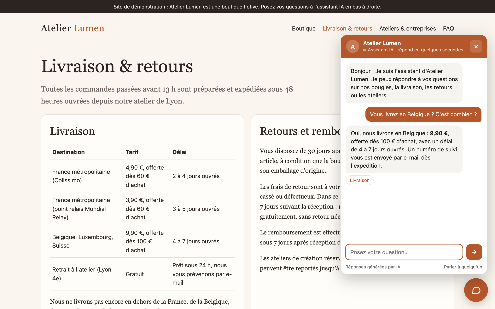
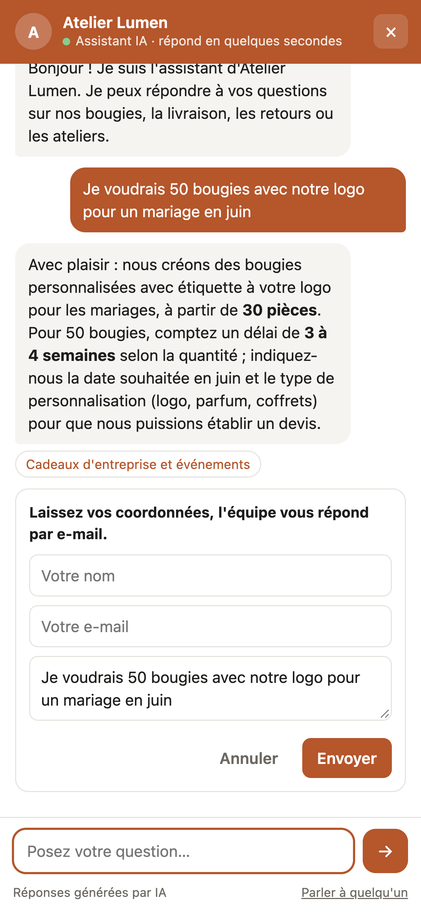
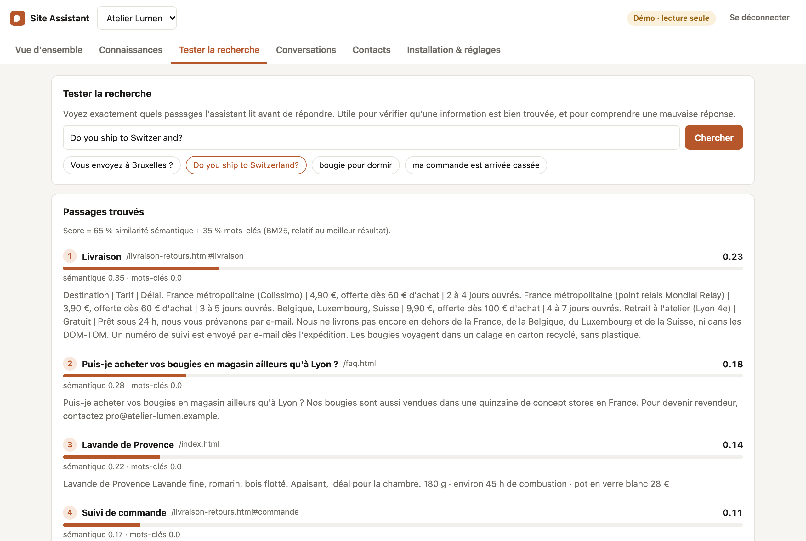
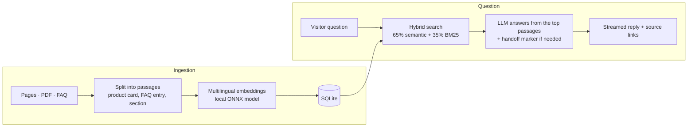

# Site Assistant

**An AI assistant that answers visitors from a website's own content, added to any site with one line of code.**

Built for web and marketing agencies: import a client's pages, PDFs and FAQ, paste one `<script>` tag on their site (WordPress, Shopify, Webflow or custom), and visitors get accurate answers with links to the right page. When the assistant can't help, or the visitor wants a quote, it hands off to the team by collecting their contact details.

> 🇫🇷 *Un assistant IA qui répond aux visiteurs à partir du contenu du site, installable en une ligne sur n'importe quel site. Pensé pour les agences, en marque blanche : vous gardez la relation client, l'assistant s'installe sous votre marque.*

**Live demo:** coming soon. Try the fictional candle shop *Atelier Lumen* and its dashboard (password `demo`, read-only).

<p align="center">
  
</p>

<p align="center">
  
  &nbsp;
  
</p>

## Features

**For visitors (the widget)**
- Answers only from the site's content, in the visitor's language (French content, English question → English answer)
- Short, streamed replies with links to the exact page section used
- Says when it doesn't know, never invents prices or policies, and declines off-topic or prompt-injection requests
- Hands off to a human: quotes, custom orders and order problems open a contact form, pre-filled with the question
- 5.8 KB gzipped, isolated in a Shadow DOM (the host site's CSS can't break it, and it can't break the site), mobile full-screen, keyboard accessible

**For the agency (the dashboard)**
- Knowledge base: import a URL (optionally the whole site), PDF, Markdown, text or HTML files; browse the indexed passages
- Search tester: see which passages the assistant reads for any question, with semantic and keyword scores
- Conversations and leads (CSV export), daily usage
- Per-site settings: name, colour, welcome message, suggested questions, tone instructions, allowed domains
- Several client sites in one installation, one `data-site` id each
- A read-only demo login, where visitors' emails and phone numbers are masked

**For running it in public**
- Rate limit per visitor and a daily message cap, so a public demo can't run up the LLM bill
- Each site can restrict which domains may use its widget

## How it works



1. **Ingestion.** HTML is split along its structure: each product card, FAQ entry and heading section becomes one passage, prefixed with its page title and heading so it makes sense on its own, and linked to its anchor.
2. **Embeddings.** Passages are embedded with [`paraphrase-multilingual-MiniLM-L12-v2`](https://huggingface.co/sentence-transformers/paraphrase-multilingual-MiniLM-L12-v2) through [fastembed](https://github.com/qdrant/fastembed) (ONNX, CPU only, no API call), so "Vous envoyez à Bruxelles ?" and "Do you ship to Switzerland?" both match the delivery section.
3. **Hybrid retrieval.** Cosine similarity is combined with BM25 keyword scores (accent folding and light French stemming), so exact product names and prices are found as reliably as paraphrases.
4. **Grounded answer.** The top passages go to the LLM with strict rules: answer only from them, in the visitor's language, briefly, and add a hidden handoff marker when a human is needed. Tokens stream to the widget over Server-Sent Events; the marker is filtered out of the stream even when it arrives split across tokens.

The LLM is any OpenAI-compatible API. It defaults to DeepSeek, and OpenAI, Mistral or a local Ollama server work by changing two variables.

## Tech stack

| Part | Stack |
|---|---|
| API | Python, FastAPI, Server-Sent Events, SQLite |
| Retrieval | fastembed (ONNX), NumPy, BM25 |
| LLM | OpenAI-compatible client (DeepSeek by default) |
| Widget | TypeScript, no framework, Shadow DOM, built with Vite |
| Dashboard | React, TypeScript, Vite |
| Tests | pytest: chunking, retrieval quality, streaming, permissions, privacy, rate limits |

## Run it locally

Requirements: Python 3.11+ and Node.js 20+.

```bash
git clone https://github.com/SoufyaneMoudabbbir/rag-site-assistant.git
cd rag-site-assistant

python3 -m venv .venv
.venv/bin/pip install -r backend/requirements.txt -r backend/requirements-dev.txt

(cd widget && npm install && npm run build)
(cd admin && npm install && npm run build)

cp .env.example .env   # add LLM_API_KEY and choose an ADMIN_PASSWORD
cd backend && ../.venv/bin/python -m uvicorn app.main:app --port 8000
```

Then open:
- http://localhost:8000: the demo shop, with the assistant in the bottom-right corner
- http://localhost:8000/admin: the dashboard (your `ADMIN_PASSWORD`, or `demo` for read-only)

On first start, the embedding model (~220 MB) is downloaded and the demo shop's pages are indexed.

Run the tests (they use a scripted LLM, so they are free and deterministic):

```bash
cd backend && ../.venv/bin/python -m pytest
```

## Add it to a website

```html
<script src="https://YOUR-SERVER/widget.js" data-site="your-site-id" defer></script>
```

| Attribute | Default | |
|---|---|---|
| `data-site` | (required) | Site id created in the dashboard |
| `data-teaser` | `false` | Show a small invitation bubble after a few seconds |
| `data-theme` | `light` | `light`, `dark`, or `auto` (follows the visitor's system) |
| `data-api` | script origin | Server URL, if the widget file is hosted elsewhere |

## Configuration

| Variable | Default | |
|---|---|---|
| `LLM_API_KEY` | | API key of the chat model |
| `LLM_BASE_URL` | `https://api.deepseek.com` | Any OpenAI-compatible endpoint |
| `LLM_MODEL` | `deepseek-flash` | |
| `ADMIN_PASSWORD` | | Full dashboard access (disabled if empty) |
| `DEMO_PASSWORD` | `demo` | Read-only dashboard access |
| `RATE_LIMIT_MESSAGES` / `RATE_LIMIT_WINDOW` | `20` / `600` | Messages per visitor per window (seconds) |
| `DAILY_MESSAGE_LIMIT` | `500` | All visitors together, per day |
| `EMBED_MODEL` | multilingual MiniLM | Any fastembed text model |
| `DATA_DIR` | `./data` | SQLite database location |

## Deploy

The `Dockerfile` builds the widget and dashboard, installs the API, and downloads the embedding model at build time so the container starts quickly. It listens on `$PORT` (7860 by default, the port Hugging Face Spaces expects).

```bash
docker build -t site-assistant .
docker run -p 7860:7860 -e LLM_API_KEY=... -e ADMIN_PASSWORD=... -v $(pwd)/data:/app/data site-assistant
```

## Design choices and limits

- **In-memory vector index per site.** Search is a NumPy matrix product over the site's passages, rebuilt when its documents change. That's instant for a typical business site (hundreds to a few thousand passages). For very large catalogues, the retrieval module is the one place to swap for pgvector or Qdrant.
- **Server-side conversation history.** The widget only sends the new question and a conversation id, so visitors can't rewrite the history the model sees.
- **One instance.** Admin sessions and rate limits live in memory, which suits a small deployment. Running several instances would need them in Redis or the database.
- **No automatic re-crawl yet.** Re-importing a URL replaces its previous version; scheduled re-imports would be a natural next step.

## Author

Built by [Soufyane Moudabbir](https://github.com/SoufyaneMoudabbbir), an AI developer working white-label with agencies.

*Atelier Lumen is a fictional shop created for this demo; any resemblance to a real business is unintended.*
